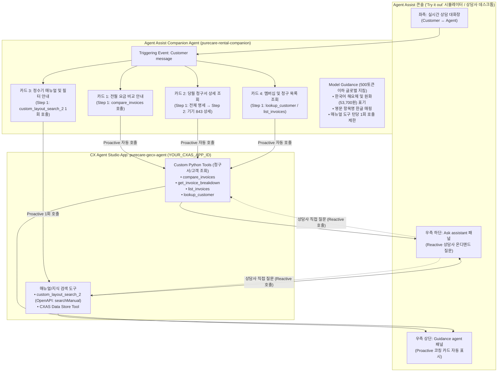
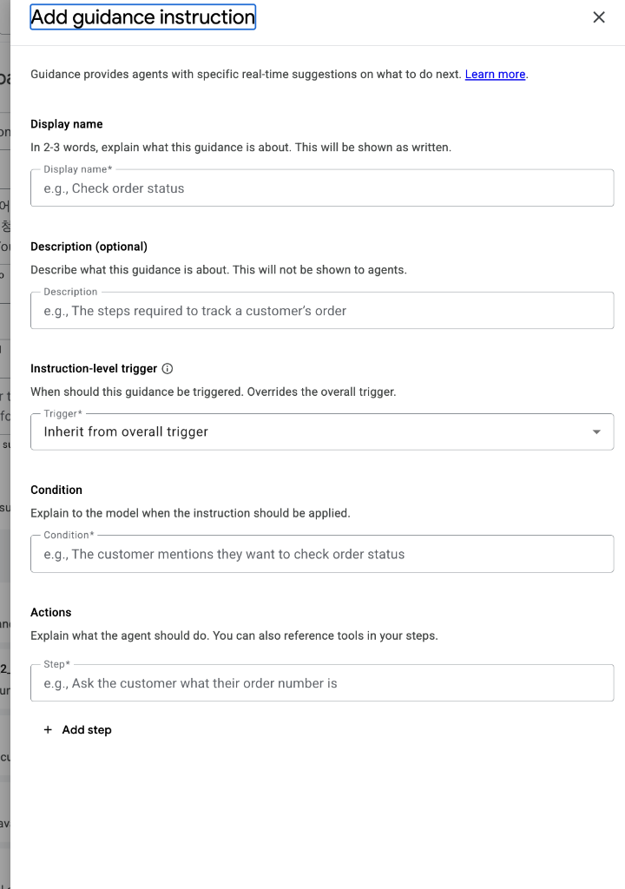
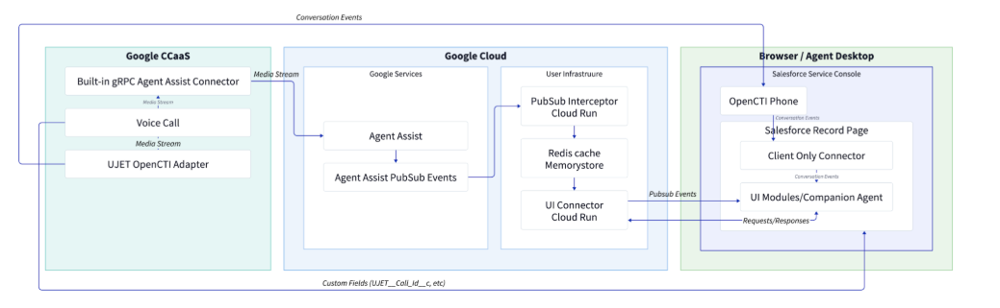

# Google Cloud Agent Assist — Companion Agent 설정 및 운영 가이드

> **문서 개요**: 본 저장소는 **Google Cloud CX Agent Studio (CES / CXAS)**에 구성된 에이전트 도구(Tools)를 활용하여, **Agent Assist Companion Agent**를 콘솔에서 단계별로 설정·검증·운영하는 방법을 안내하는 고객사 실전 가이드입니다.
> 가상의 정수기·홈케어 렌탈 브랜드인 **퓨어케어(PureCare)**의 **렌탈 요금 조회 및 제품 매뉴얼 검색 시나리오**를 기준으로 작성되어 있어, 콘솔 화면의 각 항목에 가이드의 설정값을 그대로 복사·붙여넣어 즉시 재현할 수 있습니다.

---

## 📂 저장소 폴더 구조 (Repository Structure)

```text
AA-Companion-Agent/
├── README.md                                   # [메인 가이드] Companion Agent 단계별 콘솔 설정 및 시뮬레이터 테스트 가이드
├── assets/                                     # 콘솔 UI 설정 화면 및 아키텍처 다이어그램 이미지
│   ├── add_guidance_instruction_ui.png         # Add guidance instruction 설정 팝업 화면
│   └── enterprise_integration_architecture.png # CCaaS · Agent Assist · 상담원 데스크톱 3-Plane 연동 아키텍처
├── docs/                                       # 심화 아키텍처 및 베스트 프랙티스 문서
│   ├── 01-companion-agent-overview.md          # Companion Agent 개념, 동작 모드 및 화면 구성 개요
│   ├── 02-architecture-and-best-practices.md   # 프롬프트 평가 원리, 음성/채팅 채널 전략 및 조건문 설계 베스트 프랙티스
│   └── 03-faq.md                               # 자주 묻는 제품·리전·과금·UI 연동 FAQ
└── tools/                                      # CX Agent Studio (CXAS) 연동용 샘플 도구 코드 및 스키마
    ├── README.md                               # CXAS 도구 생성 및 등록 가이드
    ├── python_tools/                           # CXAS Custom Python Function Tools (내장 샘플 데이터 및 Fallback 포함)
    │   ├── compare_invoices.py                 # 전월 대비 청구서 비교 분석 도구
    │   ├── get_invoice_breakdown.py            # 당월 청구서 전체/기기별(843 등) 상세 명세 조회 도구
    │   ├── list_invoices.py                    # 월별 청구서 발행 목록 조회 도구
    │   └── lookup_customer.py                  # 고객 멤버십 계약 및 잔액 조회 도구
    └── openapi_schemas/                        # CXAS OpenAPI Toolset 스키마 템플릿
        ├── manual_search_openapi.yaml          # 제품 매뉴얼 검색 OpenAPI 3.0 스키마 (searchManual)
        └── purifier_billing_openapi.yaml       # 렌탈 청구서 조회 OpenAPI 3.0 스키마 (getInvoices)
```

---

## 목차 (Table of Contents)

1. [Companion Agent 개요 및 연동 아키텍처](#1-companion-agent-개요-및-연동-아키텍처)
2. [사전 점검: CX Agent Studio (CXAS) 도구 확인 및 준비](#2-사전-점검-cx-agent-studio-cxas-도구-확인-및-준비)
3. [Agent Assist 콘솔 단계별 설정 가이드 (Step 1 ~ Step 6)](#3-agent-assist-콘솔-단계별-설정-가이드-step-1--step-6)
   - [Step 1: Companion Agent 생성하기](#step-1-companion-agent-생성하기)
   - [Step 2: CXAS 도구(Tools) 연결하기](#step-2-cxas-도구tools-연결하기)
   - [Step 3: Guidance Instructions (조건부 코칭 카드 4종) 추가하기](#step-3-guidance-instructions-조건부-코칭-카드-4종-추가하기)
   - [Step 4: Model Guidance (글로벌 지침) 설정하기](#step-4-model-guidance-글로벌-지침-설정하기)
   - [Step 5: Conversation Profile 생성 및 연결하기](#step-5-conversation-profile-생성-및-연결하기)
   - [Step 6: `Try it out` 시뮬레이터 테스트 케이스 (TC-01 ~ TC-09)](#step-6-try-it-out-시뮬레이터-테스트-케이스-tc-01--tc-09)
4. [실전 시연용 턴바이턴(Turn-by-Turn) 대화 시나리오](#4-실전-시연용-턴바이턴turn-by-turn-대화-시나리오)
5. [프로덕션 확장을 위한 설계 베스트 프랙티스](#5-프로덕션-확장을-위한-설계-베스트-프랙티스)
6. [API 및 상담원 데스크톱(UI) 연동 레퍼런스](#6-api-및-상담원-데스크톱ui-연동-레퍼런스)

---

## 1. Companion Agent 개요 및 연동 아키텍처

### 1.1 Companion Agent란?

**Companion Agent(컴패니언 에이전트)**는 고객 상담 중 **인간 상담사(Human Agent) 옆에서 실시간으로 협업하는 통합 AI 코파일럿(Co-pilot)**입니다. 기존에 분리되어 있던 문서 검색(Knowledge Assist), 답변 추천(Smart Reply), 단계별 코칭(AI Coach)을 **단일 통합 인터페이스**로 결합하며, 다음 두 가지 모드로 동시에 동작합니다:

| 구분 | 능동형 코칭 모드 (`Guidance agent` 패널) | 온디맨드 비서 모드 (`Ask assistant` / `Your assistant` 패널) |
| :--- | :--- | :--- |
| **작동 방식** | **Proactive Mode**: 실시간 상담 대화를 분석하여 상담사가 별도로 검색하지 않아도 다음 행동(Next Best Action)과 추천 답변을 자동 제시 | **Reactive Mode**: 상담사가 대화 도중 궁금한 사항을 직접 자연어로 질문하면 즉시 도구를 호출하거나 문서를 검색해 답변 제시 |
| **실행 트리거** | 고객 또는 상담사의 발화 이벤트(`Customer message`, `Agent message`, `End of utterance`) 발생 시 자동 평가 | 상담사가 우측 하단 **`Ask assistant`** 입력창에 직접 질문을 입력할 때 실행 |
| **백엔드 도구** | CX Agent Studio(CXAS)에서 가져온 동일한 도구(Python Function, OpenAPI, Data Store, Google Search)를 두 모드가 함께 공유 |

---

### 1.2 본 가이드의 구성 범위 및 설계 원칙

> [!IMPORTANT]
> **핵심 설계 원칙 3가지**
> 1. **CXAS 도구(`Tools`) + 조건부 가이던스(`Guidance`) 중심 아키텍처**: 현재 Public Preview 환경에서 즉시 사용 가능한 **Companion Agent의 `Tools`(CXAS 연동) + `Guidance`(조건부 코칭 카드) + `Model Guidance` + `Ask assistant`(온디맨드 검색)** 기능만으로 멀티턴 상담 코칭까지 완벽하게 구현합니다. *(참고: 별도의 `Workflow` 기능은 현재 Public Preview 대상이 아니므로 사용하지 않으며, Guidance 카드 내 **`+ Add step`** 기능으로 다단계 흐름을 구현합니다.)*
> 2. **기존 CXAS 도구 100% 재사용 (별도 Data Store 신규 구축 불필요)**: CX Agent Studio 앱(`purecare-gecx-agent`) 내부에 구성된 청구서 분석 도구들과 매뉴얼 검색 도구를 그대로 가져와 연결합니다. 아직 CXAS 앱이 없는 경우 [`tools/README.md`](tools/README.md)의 샘플 코드를 복사해 5분 만에 구성할 수 있습니다.
> 3. **본인 확인 절차 생략을 통한 빠른 응대 흐름**: 사전 인증된 고객 세션 컨텍스트(`고객명: 홍길동`, `계정 ID: ACC-2026-001`)를 기본값으로 활용하여, 고객이 질문하는 첫 턴부터 즉시 요금 비교 및 매뉴얼 조회 도구가 실행되도록 구성합니다.

---

### 1.3 대상 환경 정보 및 연동 구조

가이드 내 플레이스홀더를 고객사의 실제 GCP 환경 값으로 치환하여 사용하세요.

| 항목 | 가이드 표기값 (플레이스홀더) | 설명 및 비고 |
| :--- | :--- | :--- |
| **GCP Project ID** | `YOUR_GCP_PROJECT_ID` | CXAS 앱 및 Agent Assist 리소스가 위치한 GCP 프로젝트 ID |
| **CXAS Location** | `us` (또는 `global`) | CX Agent Studio 앱 리전 |
| **Agent Assist Location** | `global` (권장) 또는 `us` | Companion Agent 및 Conversation Profile 리전 |
| **CXAS App 이름 / ID** | `purecare-gecx-agent` (`YOUR_CXAS_APP_ID`) | 연동할 도구가 정의된 CX Agent Studio 앱 |
| **CXAS 콘솔 URL** | [CX Agent Studio 콘솔 열기](https://ces.cloud.google.com/) | 도구 동기화 모드 및 Python 코드 점검용 |
| **Agent Assist 콘솔 URL** | [Agent Assist 콘솔 열기](https://agentassist.cloud.google.com/) | Companion Agent 생성 및 `Try it out` 시뮬레이터 실행용 |



---

### 1.4 연동 대상 CXAS 도구 상세 명세

CXAS 앱(`purecare-gecx-agent`)에 정의되어 있는 도구들의 역할과 입출력 규격입니다. (전체 샘플 소스코드는 [`tools/`](tools/) 폴더에서 확인할 수 있습니다.)

| 도구 유형 (Tool Type) | 도구 이름 (Display Name) | 입력 파라미터 | 반환 데이터 요약 및 활용 시나리오 |
| :--- | :--- | :--- | :--- |
| **Custom Tool (Python)** | **`compare_invoices`** | `month="latest"`<br>`compare_to="previous"` | • 최근 청구월(3월)과 이전 청구월(2월)의 총 청구액(`total`), 차액(`difference`), 주요 변동 요인(`top_drivers`) 반환<br>• 고객이 *"이번 달 요금이 왜 더 많이 나왔나요?"*라고 문의할 때 사용 |
| **Custom Tool (Python)** | **`get_invoice_breakdown`** | `month="latest"`<br>`line=""` (전체) 또는 `"843"` (기기 끝 3자리) | • `line=""` 호출 시 계정 전체 카테고리별 청구 금액 및 보유 기기 시리얼 끝자리 목록(`product_endings`: `["048", "703", "843"]`) 반환<br>• `line="843"` 호출 시 끝자리 843번 정수기 단독 명세(기본 렌탈료 `56,946원`, 할인 `-55,445원`, 청구액 `1,500원`) 반환 |
| **Custom Tool (Python)** | **`list_invoices`** | 없음 | • 고객 계정에 발행된 월별 청구서 요약 목록(청구월, 사용 기간, 총 청구 금액)을 최신순으로 반환 |
| **Custom Tool (Python)** | **`lookup_customer`** | `customer_id="ACC-2026-001"` | • 고객의 가입 플랜(`Purifier Care Membership`), 계약 상태(`active`), 미납 잔액(`0원`), 다음 결제일 반환 |
| **OpenAPI Toolset** | **`custom_layout_search_2`**<br>(`searchManual`) | `query` (한국어 검색어, 예: `"필터 교환 방법"`, `"출수 불량"`) | • 퓨어케어 정수기(`PC-5820L`) 공식 매뉴얼 본문(`text`), 출처 문서명(`source`), 페이지 번호(`page`), 도면 이미지 URL(`uri`), 원본 PDF URL(`pdf_uri`) 반환 |
| **Data Store Tool** | **CXAS 내 기존 Data Store 도구** *(선택)* | 자동 검색 쿼리 | • CXAS 앱에 이미 연결된 Vertex AI Search 데이터 스토어를 통해 정수기 FAQ/매뉴얼 문서 검색 |

---

## 2. 사전 점검: CX Agent Studio (CXAS) 도구 확인 및 준비

Agent Assist 콘솔에서 Companion Agent를 설정하기 전에, [CX Agent Studio 콘솔](https://ces.cloud.google.com/)에서 아래 2가지 항목을 먼저 확인합니다.

### 2.1 도구 실행 방식(Execution Type) `Synchronous` 확인
Companion Agent로 가져올 모든 CXAS 도구는 CX Agent Studio 내에서 실행 방식이 **`Synchronous`(동기식)**로 설정되어 있어야 합니다.

### 2.2 Python 청구서 도구의 세션 변수(`context.state`) 기본값 Fallback 확인

> [!WARNING]
> **점검이 필요한 이유**:
> CXAS의 Python 함수 도구(`compare_invoices`, `get_invoice_breakdown`, `list_invoices`, `lookup_customer`)는 기본적으로 CXAS 세션 상태 변수인 `context.state.get("auth_status")`와 `context.state.get("account_id")`를 읽어 동작합니다.
> 그러나 **Agent Assist의 Companion Agent에서 해당 Python 도구를 직접 호출할 때는 CXAS의 세션 변수(`context.state`)가 비어 있는 상태로 전달될 수 있습니다.** 이때 기본값(Fallback) 처리가 없으면 `"unauthenticated"` 또는 `"no account"` 에러가 발생합니다.

따라서 CX Agent Studio 콘솔 > **Tools**에서 각 Python 도구의 시작 부분에 아래와 같이 **`or "authenticated"` 및 `or "ACC-2026-001"` 기본값(Fallback) 처리**가 적용되어 있는지 확인합니다 (완성된 전체 코드는 [`tools/python_tools/`](tools/python_tools/) 참조):

```diff
 # compare_invoices / get_invoice_breakdown / list_invoices 상단 Entrypoint 내부:
-    if context.state.get("auth_status", "") != "authenticated":
-        return _auth_error()
-    account_id = context.state.get("account_id", "")
+    auth_status = context.state.get("auth_status") or "authenticated"
+    if auth_status != "authenticated":
+        return _auth_error()
+    account_id = context.state.get("account_id") or "ACC-2026-001"
     if not account_id:
         return {"status": "error", "error": "no account",
                 "agent_action": "Treat the caller as unverified and escalate."}
-    lang = context.state.get("active_language", "") or "English"
+    lang = context.state.get("active_language") or "Korean"
```

```diff
 # lookup_customer 상단 Entrypoint 내부:
-def lookup_customer(customer_id: str) -> dict:
-    auth_status = context.state.get("auth_status", "")
+def lookup_customer(customer_id: str = "ACC-2026-001") -> dict:
+    auth_status = context.state.get("auth_status") or "authenticated"
+    customer_id = customer_id or context.state.get("account_id") or "ACC-2026-001"
```

---

## 3. Agent Assist 콘솔 단계별 설정 가이드 (Step 1 ~ Step 6)

공식 [Companion Agent 설정 가이드](https://docs.cloud.google.com/gemini-enterprise-cx/agent-assist/companion-agent-set-up-guide) 절차에 맞춘 콘솔 UI 설정 방법입니다.

---

### Step 1: Companion Agent 생성하기

1. [Agent Assist 콘솔](https://agentassist.cloud.google.com/)에 접속하여 상단에서 프로젝트(**`YOUR_GCP_PROJECT_ID`**)와 리전(**`global`** 권장)을 선택합니다.
2. 좌측 메뉴에서 **Companion agent**를 클릭하고 상단의 **Create** 버튼을 클릭합니다.
3. 기본 정보를 입력합니다:
   - **Display name** *(최대 63자)*:
     ```text
     purecare-rental-companion
     ```
   - **Description** *(관리자용 설명)*:
     ```text
     퓨어케어(PureCare) 정수기 및 홈케어 렌탈 상담사를 실시간으로 지원하는 AI 컴패니언 에이전트입니다. CXAS(purecare-gecx-agent)의 청구서 분석 도구 및 매뉴얼 검색 도구를 활용하여 실시간 코칭 카드(Guidance)와 온디맨드 검색(Ask assistant)을 제공합니다.
     ```
4. **Save** (또는 **Create**)를 클릭합니다.

---

### Step 2: CXAS 도구(Tools) 연결하기

생성된 `purecare-rental-companion` 화면의 **Tools** 섹션에서 CXAS 앱(`purecare-gecx-agent`)의 도구들을 가져옵니다.

1. **`purecare-rental-companion`** 상세 화면의 **Tools** 섹션에서 **Add (`+`)** 버튼을 클릭합니다.
2. **CX Agent Studio agent** 드롭다운에서 **`purecare-gecx-agent`** (`YOUR_CXAS_APP_ID`)를 선택합니다.
3. **Tool Type**과 **Tool**을 선택하여 아래 도구들을 각각 추가합니다:

#### 2-A. 청구서 및 고객 조회 도구 4종 추가
- **Tool Type**: `Custom tool` (Python Function Tool)
- **Tool**: 아래 4개 도구를 각각 선택하여 등록합니다:
  - `compare_invoices`
  - `get_invoice_breakdown`
  - `list_invoices`
  - `lookup_customer`
- **Trigger 및 실행 옵션 설정**:
  - **Trigger**: ✅ **`Proactive Suggestion`** (코칭 카드에서 자동 호출) 및 ✅ **`Reactive Suggestion`** (`Ask assistant` 창에서 상담사 직접 질문 시 호출) **모두 체크**
  - **Human confirmation**: **`OFF` (Not required)** (단순 조회 도구이므로 상담사 승인 클릭 없이 즉시 실행)
  - **Run tool asynchronously**: **`OFF`** (응답 시간이 1.5초 이상 걸리는 외부 API인 경우에만 `ON` 권장)
- **Add**를 클릭합니다.

#### 2-B. 정수기 매뉴얼 검색 도구 추가 (`OpenAPI` 또는 `Data Store`)
- `purecare-gecx-agent` 내에 구성된 매뉴얼 검색 도구를 아래와 같이 추가합니다:
  - **Tool Type**: `OpenAPI` (또는 `OpenAPI toolset`) 선택 ➡️ **Tool**: **`custom_layout_search_2`** (`searchManual`) 선택
  - *(선택 사항)* CXAS 내 Data Store 도구도 함께 사용하는 경우 **Tool Type**: `Data Store` 선택 ➡️ 해당 Data Store 도구 추가
  - **Trigger**: ✅ **`Proactive Suggestion`** + ✅ **`Reactive Suggestion`** 모두 체크
  - **Human confirmation**: **`OFF` (Not required)**
- 모든 도구를 추가한 후 화면의 **Save** 버튼을 클릭합니다.

---

### Step 3: Guidance Instructions (조건부 코칭 카드 4종) 추가하기

Companion Agent 편집 화면의 **Guidance** 섹션 상단에서 전체 **Triggering event**를 **`Customer message`**로 선택한 뒤, **Add (`+`)** 버튼을 클릭합니다.

아래 화면과 같이 **`Add guidance instruction`** 팝업 창이 열립니다:



#### 📋 `Add guidance instruction` 팝업 항목별 역할 및 작성 요령

| 팝업 항목명 (UI 라벨) | AI 모델 전달 여부 | 역할 및 작성 가이드 |
| :--- | :---: | :--- |
| **Display name\*** | ✅ 전달됨 (카드 제목) | *"In 2-3 words, explain what this guidance is about. This will be shown as written."*<br>상담사 코칭 카드 상단에 그대로 표시되는 제목입니다. **2~3어절로 간결하게** 작성합니다. |
| **Description (optional)** | ❌ **전달 안 됨** | *"Describe what this guidance is about. This will not be shown to agents."*<br>관리자 전용 내부 메모입니다. **상담사 화면이나 AI 모델에 전혀 전달되지 않으므로** 중요한 규칙이나 도구 호출 지시는 절대 여기에만 적지 마세요. |
| **Instruction-level trigger (`Trigger*`)** | 시스템 사전 필터 | *"When should this guidance be triggered. Overrides the overall trigger."*<br>**`Customer message`**(또는 전체 트리거가 이미 `Customer message`라면 기본값 `Inherit from overall trigger`)로 설정하여 고객이 말했을 때만 평가되도록 합니다. |
| **Condition (`Condition*`)** | ✅ 전달됨 (조건 평가) | *"Explain to the model when the instruction should be applied."*<br>한 줄 텍스트 입력창입니다. 어떤 고객 발화 상황에서 이 카드를 활성화할지 명확한 긍정문으로 작성합니다. |
| **Actions (`Step*` / `+ Add step`)** | ✅ 전달됨 (실행 및 코칭) | *"Explain what the agent should do. You can also reference tools in your steps."*<br>한 줄 텍스트 입력창입니다. 호출할 도구와 안내 내용을 한 문장으로 작성하며, **2단계 멀티턴 진행이 필요한 경우 하단의 `+ Add step`을 클릭**해 두 번째 `Step*`을 추가합니다. |

---

#### 💡 Guidance 카드 1: 전월 대비 렌탈 요금 인상/변동 비교 안내

**`Add guidance instruction`** 팝업의 각 입력란에 아래 내용을 복사해 붙여넣고 **Add**를 클릭합니다:

- **Display name\***:
  ```text
  전월 요금 비교 안내
  ```
- **Description (optional)**:
  ```text
  고객이 지난달 대비 청구 금액 차이 또는 요금 인상 이유를 문의할 때 최근 2개월 청구서를 비교 분석합니다.
  ```
- **Instruction-level trigger (`Trigger*`)**:
  ```text
  Customer message (또는 Inherit from overall trigger)
  ```
- **Condition (`Condition*`)**:
  ```text
  고객이 이번 달 렌탈 요금이 평소나 지난달보다 왜 더 많이 나왔는지 묻거나 전월 대비 청구 요금 차이와 인상 이유를 문의하는 경우
  ```
- **Actions — `Step*` (1번째 입력칸)**:
  ```text
  본인 인증 없이 즉시 compare_invoices 도구를 month="latest", compare_to="previous"로 호출하여 이번 달(3월)과 지난달(2월) 총 청구 금액, 차액, 주요 변동 요인(top_drivers)을 한국어로 안내하고 당월 상세 명세 확인 여부를 제안하세요.
  ```

---

#### 💡 Guidance 카드 2: 당월 청구서 상세 명세 및 기기별(시리얼 끝자리) 2단계 조회

> [!TIP]
> **`+ Add step`을 활용한 2단계 멀티턴 코칭**:
> 첫 번째 `Step*` 입력 후 팝업 하단의 **`+ Add step`**을 클릭하여 두 번째 `Step*`을 추가합니다. 고객이 전체 내역을 물어볼 때는 1번째 Step이 실행되어 보유 기기 끝자리(`048, 703, 843`)를 안내하고, 이어서 고객이 *"끝자리 843번만 자세히 봐주세요"*라고 말하면 동일한 카드가 자동으로 2번째 Step으로 전환되어 `line="843"` 도구를 재호출합니다.

- **Display name\***:
  ```text
  당월 청구서 상세 조회
  ```
- **Description (optional)**:
  ```text
  1단계로 계정 전체의 당월 청구 명세와 보유 기기 끝자리를 안내하고, 2단계로 고객이 지정한 기기(예: 843)의 개별 명세를 조회합니다.
  ```
- **Instruction-level trigger (`Trigger*`)**:
  ```text
  Customer message (또는 Inherit from overall trigger)
  ```
- **Condition (`Condition*`)**:
  ```text
  고객이 이번 달 렌탈 청구서의 세부 항목 내역을 알고 싶어 하거나 보유 중인 특정 렌탈 기기(시리얼 번호 끝 3자리, 예: 843)의 개별 요금 명세를 문의하는 경우
  ```
- **Actions — 1번째 `Step*` 입력칸**:
  ```text
  get_invoice_breakdown 도구를 month="latest", line=""으로 호출하여 계정 전체의 카테고리별 청구 금액과 총합계를 안내하고, 응답의 product_endings(예: 048, 703, 843)를 바탕으로 특정 기기의 세부 요금 내역도 개별 확인해 드릴지 고객에게 물어보세요.
  ```
- **Actions — `+ Add step` 클릭 후 2번째 `Step*` 입력칸**:
  ```text
  고객이 특정 기기의 시리얼 번호 끝 3자리(예: "843")를 지정하면 get_invoice_breakdown 도구를 month="latest", line="843"으로 호출하여 해당 기기의 기본 렌탈료, 방문 케어 서비스료, 소모품 추가 비용, 할인액을 상세히 안내하세요.
  ```

---

#### 💡 Guidance 카드 3: 정수기 매뉴얼 · 필터 교환 주기 · 자가 점검 안내

> [!WARNING]
> **매뉴얼 검색 도구 4회 연속 호출(Loop) 방지 필수 설정**:
> 정수기 사용 설명서 원본 PDF(`PC-5820L-Manual`)에는 **필터 교환 방법**과 **이상 증상 점검 순서**만 기재되어 있고, **필터별 권장 교환 주기(네오센스 6개월, RO 멤브레인 20개월, 플러스이노센스 18개월) 개월 수 데이터는 매뉴얼 본문에 포함되어 있지 않은 경우**가 많습니다.
> 따라서 아래 `Step*` 문구처럼 **(1) `custom_layout_search_2` 도구를 딱 1회만 호출하도록 명시**하고 **(2) 필터별 교환 주기 기준값을 지침에 함께 제공**해야 AI가 개월 수를 찾느라 도구를 4번 연속 재호출(Max Tool Loop)하며 멈추는 현상을 완벽히 방지할 수 있습니다.

- **Display name\***:
  ```text
  정수기 매뉴얼 및 필터 안내
  ```
- **Description (optional)**:
  ```text
  정수기 필터 교환 주기, 자가 교환 방법, 이상 증상 문의 시 매뉴얼 검색 도구를 1회 호출하여 답변과 출처를 제공합니다.
  ```
- **Instruction-level trigger (`Trigger*`)**:
  ```text
  Customer message (또는 Inherit from overall trigger)
  ```
- **Condition (`Condition*`)**:
  ```text
  고객이 정수기의 필터 교체(교환) 주기, 필터 교환 방법, 이상 증상(누수, 출수 불량, 소음 등), 청소 관리 방법, 또는 제품 사용 설명서를 문의하는 경우
  ```
- **Actions — `Step*` (1번째 입력칸)**:
  ```text
  핵심 키워드(예: "필터 교환 방법", "출수 불량")로 custom_layout_search_2 도구를 딱 1회만 호출한 뒤 추가 재검색 없이 즉시 답변을 작성하세요(필터 교환 주기는 네오센스 6개월, RO 멤브레인 20개월, 플러스이노센스 18개월로 안내하고 매뉴얼 조치 순서와 출처 페이지를 요약하세요).
  ```

---

#### 💡 Guidance 카드 4: 고객 렌탈 멤버십 계약 정보 및 월별 청구서 목록 조회

- **Display name\***:
  ```text
  멤버십 및 청구 목록 조회
  ```
- **Description (optional)**:
  ```text
  고객의 렌탈 케어 멤버십 가입 상태, 현재 잔액, 또는 과거 월별 청구서 발행 목록을 조회합니다.
  ```
- **Instruction-level trigger (`Trigger*`)**:
  ```text
  Customer message (또는 Inherit from overall trigger)
  ```
- **Condition (`Condition*`)**:
  ```text
  고객이 본인의 렌탈 케어 멤버십 가입 상품, 계약 상태, 현재 잔액, 또는 최근 몇 달간의 청구서 발행 내역 목록을 확인하고 싶어 하는 경우
  ```
- **Actions — `Step*` (1번째 입력칸)**:
  ```text
  멤버십 상태나 잔액 문의 시 lookup_customer(customer_id="ACC-2026-001")를 호출하고 과거 청구서 내역 문의 시 list_invoices 도구를 호출하여 멤버십 플랜명, 정상 이용 상태, 잔액 및 월별 청구서 목록을 요약해 안내하세요.
  ```

---

### Step 4: Model Guidance (글로벌 지침) 설정하기

> [!IMPORTANT]
> **500 토큰 제한 준수 (`Overarching guidance length exceeds max token count 500`)**:
> 콘솔의 **Model Guidance** 입력란은 최대 **500 토큰**(한국어 기준 약 250~300자 내외)까지만 허용됩니다. 아래 지침은 필수 규칙(본인 확인 생략, 원화 금액 표기, 영문 카테고리 한국어 매핑, 매뉴얼 도구 1회 호출 제한 및 필터 주기)을 모두 포함하면서도 **약 170 토큰**으로 최적화되어 있어 에러 없이 즉시 저장됩니다.

Companion Agent 편집 화면 하단의 **Model Guidance** 입력란에 아래 내용을 붙여넣고 **Save**를 클릭합니다:

```text
퓨어케어 상담사 지원 AI입니다. 모든 코칭과 추천 답변은 정중한 한국어(해요체)로 간결히 작성하세요.
1. 본인 확인 생략: 사전 인증 고객(홍길동, ACC-2026-001)이므로 즉시 도구를 호출하세요.
2. 금액 및 번역: 쉼표와 '원' 표기(53,700원). Rental Fees=기본 렌탈료, Service Fees=방문 케어료, Discounts=할인액, Other Fees=소모품/필터 추가 비용, Registration Fees=등록/설치비.
3. 도구 규칙: month는 영문(latest, previous) 사용. custom_layout_search_2는 턴당 딱 1회만 호출하고 즉시 답변 작성('교체'는 '교환'으로 검색, 필터 주기는 네오센스 6개월/RO 멤브레인 20개월/플러스이노센스 18개월 기준).
```

---

### Step 5: Conversation Profile 생성 및 연결하기

1. [Agent Assist 콘솔](https://agentassist.cloud.google.com/) 좌측 메뉴에서 **Conversation profiles**로 이동한 뒤 상단의 **Create**를 클릭합니다.
2. **Display name**에 `purecare-companion-demo-profile`을 입력합니다.
3. **Suggestion types** 섹션에서 **Companion agent**를 체크(활성화)하고, 드롭다운에서 방금 생성한 **`purecare-rental-companion`**을 선택합니다.
4. 하단의 **Save**를 클릭하여 프로필 생성을 완료합니다.
5. 생성된 프로필 상세 화면 우측 상단의 **`Try it out`** 버튼을 클릭하면 실시간 대화 시뮬레이터가 열립니다.

---

### Step 6: `Try it out` 시뮬레이터 테스트 케이스 (TC-01 ~ TC-09)

`Try it out` 시뮬레이터 화면에서 아래 9개 테스트 케이스를 순서대로 입력하여 **능동형 코칭 카드(`Guidance agent`)**와 **온디맨드 어시스턴트(`Ask assistant`)** 동작을 검증합니다.

#### Part A. 능동형 코칭 카드 검증 (좌측 하단 `Customer` 입력창에 입력)

> [!TIP]
> **시뮬레이터 테스트 팁**:
> 1. 좌측 하단 **`Customer`** 입력창(`Type a customer's message`)에 질문을 입력해 코칭 카드가 생성되면, 다음 고객 질문을 입력하기 전에 **`Agent`** 입력창(`Type an agent's message`)에 추천 답변을 한 번 입력해 대화 턴을 완결해 주세요.
> 2. 우측 상단 코칭 카드 제목 옆에 **`<` `>` `>|` 페이지 이동 화살표**가 표시되면 **`>|` (가장 최신 카드로 이동)** 버튼을 클릭하여 새로 생성된 카드를 확인합니다.

| TC ID | 검증 대상 Guidance 카드 및 도구 | 좌측 `Customer` 입력창에 입력할 문구 | 우측 상단 `Guidance agent` 기대 결과 |
| :---: | :--- | :--- | :--- |
| **TC-01** | **카드 1**: `전월 요금 비교 안내`<br>(`compare_invoices`) | `이번 달 정수기 렌탈 요금이 지난달보다 왜 더 많이 나왔나요?` | • **`전월 요금 비교 안내`** 카드 생성<br>• `compare_invoices(month="latest", compare_to="previous")` 자동 실행<br>• 3월 vs 2월 총 청구액, 차액, 주요 변동 요인(한글 매핑) 및 상세 명세 확인 제안 표시 |
| **TC-02** | **카드 2 (1번째 Step)**: `당월 청구서 상세 조회`<br>(`get_invoice_breakdown` 계정 전체) | `네, 이번 달 청구서 전체 세부 항목 내역을 알려주세요.` | • **`당월 청구서 상세 조회`** 카드(1번째 Step) 생성<br>• `get_invoice_breakdown(month="latest", line="")` 자동 실행<br>• 최종 납부 금액(`5,370원`) 및 등록 기기 3대(`끝자리 048, 703, 843`) 안내, 개별 기기 조회 제안 |
| **TC-03** | **카드 2 (2번째 Step)**: `당월 청구서 상세 조회`<br>(`get_invoice_breakdown` 기기 지정) | `제가 쓰는 기기 중에 끝자리 843번 정수기 요금 내역만 따로 자세히 봐주세요.` | • 동일 카드가 **2번째 Step**으로 자동 전환<br>• `get_invoice_breakdown(month="latest", line="843")` 재호출<br>• 끝자리 `843`번 기기의 기본 렌탈료(`56,946원`), 결합/제휴 할인(`55,445원`), 최종 청구액(`1,500원`) 표시 |
| **TC-04** | **카드 3**: `정수기 매뉴얼 및 필터 안내`<br>(`custom_layout_search_2` 1회 호출) | `정수기 필터 교체 주기가 몇 개월인지랑, 제가 직접 필터를 갈아끼우는 방법을 알려주세요.` | • **`정수기 매뉴얼 및 필터 안내`** 카드 생성<br>• `Custom layout search 2` 도구 **1회 실행**<br>• 필터별 교환 주기(네오센스 6개월, RO 20개월, 이노센스 18개월) + 매뉴얼 필터 교환 절차 및 출처 페이지 표시 |
| **TC-05** | **카드 3**: `정수기 매뉴얼 및 필터 안내`<br>(이상 증상 / 자가 점검 검색) | `정수기에서 갑자기 물이 안 나오는데(출수 불량) 어떻게 점검해야 하나요?` | • **`정수기 매뉴얼 및 필터 안내`** 카드 생성<br>• 매뉴얼 내 출수 불량 시 점검 순서(원수 공급 밸브, 전원 플러그, 필터 커버 닫힘 확인 등) 표시 |
| **TC-06** | **카드 4**: `멤버십 및 청구 목록 조회`<br>(`lookup_customer` / `list_invoices`) | `제 렌탈 케어 멤버십 가입 상태랑 지금까지 발행된 월별 청구서 목록을 확인해 주세요.` | • **`멤버십 및 청구 목록 조회`** 카드 생성<br>• `lookup_customer` 및 `list_invoices` 실행<br>• 멤버십 플랜(`Purifier Care Membership`), 정상 상태(`active`), 잔액(`0원`) 및 월별 고지서 목록 표시 |

---

#### Part B. 온디맨드 비서 검증 (우측 하단 `Ask assistant` 입력창에 직접 질문)

> [!TIP]
> **테스트 방법**: 시뮬레이터 우측 하단의 **`Ask assistant`** 패널 입력창(`Say something to your assistant`)에 상담사 입장에서 아래 질문을 직접 입력합니다.

| TC ID | 검증 대상 도구 | 우측 하단 `Ask assistant` 입력창에 입력할 문구 | 기대 결과 (`Ask assistant` 응답 패널) |
| :---: | :--- | :--- | :--- |
| **TC-07** | 매뉴얼 검색 도구<br>(`custom_layout_search_2`) | `정수기에서 갑자기 물이 안 나올 때(출수 불량) 매뉴얼상 점검해야 하는 순서를 알려줘.` | • `Custom layout search 2` 실행 완료 표시(`✅`)<br>• 1~4단계 점검 사항(원수 밸브, 단수 여부, 전원 및 표시부, 필터 커버 확인) 및 AS 접수 안내 출력 |
| **TC-08** | 청구서 비교 도구<br>(`compare_invoices`) | `이 고객의 이번 달(latest)과 지난달(previous) 렌탈 청구 금액 차이와 주요 변동 원인을 알려줘.` | • `compare_invoices` 도구 즉시 실행<br>• 3월/2월 총액 비교 및 변동 항목 요약 반환 |
| **TC-09** | 기기별 명세 도구<br>(`get_invoice_breakdown`) | `끝자리 843번 정수기의 이번 달 상세 청구 항목 내역을 조회해 줘.` | • `get_invoice_breakdown(month="latest", line="843")` 실행<br>• `843`번 기기 기본 렌탈료(`56,946원`), 할인(`55,445원`), 최종 청구 금액(`1,500원`) 반환 |

---

## 4. 실전 시연용 턴바이턴(Turn-by-Turn) 대화 시나리오

고객사 시연 또는 내부 교육 시 시뮬레이터에서 자연스러운 상담 흐름을 보여줄 수 있는 대화형 스크립트입니다.

### 🎬 Turn 1: 전월 대비 요금 인상 문의 (`전월 요금 비교 안내` 카드 발동)
- **Customer 입력**:
  ```text
  안녕하세요, 이번 달 정수기 렌탈 요금 청구서를 봤는데 지난달보다 금액이 왜 이렇게 많이 나왔나요?
  ```
- **확인 포인트**: 우측 상단에 **`전월 요금 비교 안내`** 카드가 즉시 생성되며 `compare_invoices` 도구가 실행됩니다.
- **Agent 응대 입력**:
  ```text
  홍길동 고객님, 안녕하세요! 바로 조회해 보았습니다. 지난달과 비교해 보니 이번 달 청구서에는 할인 및 청구 항목 변동이 반영되어 차이가 발생했습니다. 이번 달 청구서의 전체 상세 명세도 함께 확인해 드릴까요?
  ```

### 🎬 Turn 2: 당월 전체 청구 명세 조회 (`당월 청구서 상세 조회` — Step 1 발동)
- **Customer 입력**:
  ```text
  네, 이번 달 청구서 전체 세부 항목 내역을 알려주세요.
  ```
- **확인 포인트**: 우측 상단에 **`당월 청구서 상세 조회`** 카드(1번째 Step)가 뜨며 `get_invoice_breakdown(month="latest", line="")`가 실행됩니다.
- **Agent 응대 입력**:
  ```text
  이번 달 전체 청구 금액에서 할인이 차감되어 최종 납부하실 금액은 5,370원입니다. 현재 고객님 명의로 등록된 기기가 총 3대(끝자리 048, 703, 843) 있으신데요, 혹시 특정 기기의 개별 세부 요금 내역도 확인해 드릴까요?
  ```

### 🎬 Turn 3: 끝자리 `843`번 기기 개별 명세 조회 (`당월 청구서 상세 조회` — Step 2 자동 전환)
- **Customer 입력**:
  ```text
  제가 쓰는 기기 중에 끝자리 843번 정수기 요금 내역만 따로 자세히 봐주세요.
  ```
- **확인 포인트**: 동일한 **`당월 청구서 상세 조회`** 카드가 자동으로 2번째 Step으로 진행되며 `get_invoice_breakdown(month="latest", line="843")`를 호출합니다.
- **Agent 응대 입력**:
  ```text
  고객님이 문의하신 끝자리 843번 정수기의 이번 달 세부 요금 내역을 안내해 드리겠습니다. 기본 렌탈료는 56,946원이며, 여기에 결합 및 제휴 할인이 55,445원 적용되어 이 기기에 대해 이번 달 최종 청구된 금액은 1,500원입니다.
  ```

### 🎬 Turn 4: 정수기 필터 교환 주기 및 출수 불량 매뉴얼 안내 (`정수기 매뉴얼 및 필터 안내` 카드 & `Ask assistant`)
- **Customer 입력**:
  ```text
  아, 이해됐습니다! 그리고 제가 쓰는 정수기 필터 교체 주기가 몇 개월인지랑, 제가 직접 필터를 갈아끼우는 방법도 알려주세요.
  ```
- **확인 포인트**: 우측 상단(`>|` 버튼 클릭)에 **`정수기 매뉴얼 및 필터 안내`** 카드가 생성되며 `Custom layout search 2`가 딱 1회 호출된 후 필터별 교환 주기(6/20/18개월)와 교환 절차가 표시됩니다. 추가 기술 문의(예: 출수 불량 점검 순서)는 우측 하단 **`Ask assistant`** 창에 직접 질문하여 실시간 검색 결과를 시연합니다.

---

## 5. 프로덕션 확장을 위한 설계 베스트 프랙티스

실제 콜센터/채팅 상담 환경으로 Companion Agent를 확장할 때 반드시 적용해야 할 핵심 설계 원칙입니다. (보다 자세한 내용은 [`docs/02-architecture-and-best-practices.md`](docs/02-architecture-and-best-practices.md)를 참고하세요.)

### 5.1 상담 채널별(음성 콜 vs 디지털 채팅) 설정 전략

| 설계 항목 | 음성 콜센터 (Voice / Telephony) | 디지털 채팅 (Digital Chat / Messaging) |
| :--- | :--- | :--- |
| **권장 기본 트리거** | `End of utterance` *(단, 일반 문의 카드는 개별 트리거를 `Customer message`로 오버라이드 권장)* | `Customer message` (고객이 메시지를 보낸 직후에만 평가) |
| **추천 답변 길이 및 스타일** | 상담사가 바로 읽을 수 있는 구어체 1~2문장 이내. 불릿 포인트나 긴 URL 링크 지양 | 명확한 불릿 포인트, 금액 표, 매뉴얼 링크 등 구조화된 텍스트 활용 가능 |
| **Opening Utterance Trap 방지** | 음성 콜에서는 상담사가 먼저 첫인사(*"반갑습니다, 퓨어케어 고객센터입니다"*)를 건넵니다. 트리거가 `End of utterance`로 되어 있으면 상담사의 첫인사 직후에 카드가 조기 발동할 수 있으므로, **고객 문의 기반 카드는 반드시 `Instruction-level trigger`를 `Customer message`로 설정**하세요. |

---

### 5.2 콜 컨텍스트(`Inject context` / `context_references`) 연동 및 조건 분기 패턴

IVR이나 CRM에서 전달된 세션 메타데이터(예: `CUSTOMERCONTEXT`)는 모델 프롬프트 내에 대문자 마크다운 헤더와 JSON 형태로 주입됩니다:

```text
### CUSTOMERCONTEXT
{"customer_tier": "VIP", "ivr_authenticated": "true"}
```

시뮬레이터 상단의 **`Inject context`** 버튼을 눌러 위와 같은 JSON 컨텍스트를 주입하며 테스트할 수 있으며, `Condition*` 작성 시 다음 3가지 표준 패턴을 사용합니다:

1. **패턴 1 — 대화 의도 기반 조건 (Conversational Intent)**
   - 단순 키워드 나열이나 부정문(*"첫인사 때는 제외"*)을 피하고, 고객의 구체적인 발화 상황을 긍정문으로 서술합니다.
   - *예시*: `"고객이 이번 달 렌탈 요금이 평소나 지난달보다 왜 더 많이 나왔는지 묻거나 전월 대비 요금 차이를 문의하는 경우"`
2. **패턴 2 — 컨텍스트 보장 시 조건 분기 (Guaranteed Context)**
   - IVR/CRM 컨텍스트가 항상 전달되는 환경에서는 대문자 섹션명과 정확한 `"key": "value"` 문자열을 인용합니다.
   - *예시*: `CUSTOMERCONTEXT 섹션에 "ivr_authenticated": "true" 텍스트가 정확히 포함된 경우에만 적용합니다.`
3. **패턴 3 — 컨텍스트 누락 대비 안전 분기 (Fail-Safe Default / Exception 패턴)**
   - 네트워크 지연 등으로 콜 컨텍스트가 비어 있을 때 본인 확인이 누락되지 않도록, **인증 요구 카드를 `DEFAULT`**로, **인증 생략 카드를 `EXCEPTION`**으로 분리하고 서로의 카드 제목(`Display name`)을 교차 참조하여 동시 발동을 방지합니다.

---

### 5.3 `Actions > Step*` 분할 원칙 (The Checkpoint Rule)

- **언제 `+ Add step`으로 분리해야 하나요?**
  - **실제 대화 턴(Turn)이나 도구 실행 체크포인트가 나뉠 때만 분리**합니다. (예: `1번째 Step`에서 전체 청구 내역과 기기 끝자리를 안내하고 고객의 기기 선택 답변을 기다린 후, 고객이 `"843번"`을 말했을 때 `2번째 Step`에서 해당 기기를 조회하는 경우)
- **절대 단독 `Step*`으로 분리하면 안 되는 경우**:
  - *"생년월일은 묻지 마세요"*와 같은 **부정 제약(Negative Constraint)**이나 *"두 문장 이내로 답하세요"* 같은 **포맷팅 규칙**을 별도의 `Step*` 칸으로 분리하면, 대화록에 완료 증거가 남지 않아 AI가 해당 Step에서 다음 Step으로 넘어가지 못하고 멈추게 됩니다. 제약 조건은 반드시 행동 지시와 **같은 `Step*` 입력칸 안**에 함께 작성하세요.

---

## 6. API 및 상담원 데스크톱(UI) 연동 레퍼런스

### 6.1 상담원 데스크톱(Agent Desktop) 및 CCaaS 통합 아키텍처

고객사의 기존 상담원 데스크톱(Salesforce Service Console, Genesys, 커스텀 웹 콘솔 등)에 Companion Agent를 임베드할 때의 표준 3-Plane 참조 아키텍처입니다.



1. **CCaaS → Agent Assist (Server-side Stream)**: 음성 또는 채팅 스트림이 gRPC/AnalyzeContent를 통해 Agent Assist로 전달되어 능동형 코칭 카드(`Guidance agent`)를 생성합니다.
2. **Agent Assist → UI Connector (Pub/Sub & Cloud Run)**: 생성된 추천 이벤트가 Pub/Sub Interceptor 및 UI Connector를 거쳐 브라우저의 UI Module로 실시간 전달됩니다.
3. **Agent Desktop ↔ Streaming Reactive API**: 상담사가 `Ask assistant` 패널에 질문을 입력하면 양방향 스트리밍 RPC를 통해 실시간 도구 호출 상태와 답변 청크를 수신합니다.

---

### 6.2 Streaming Reactive Companion API (`Ask assistant` 백엔드 연동 규격)

커스텀 상담원 UI에서 온디맨드 어시스턴트(`Ask assistant`)를 직접 연동할 때는 아래의 양방향 gRPC 스트리밍 API를 호출합니다. ([공식 문서 참조](https://docs.cloud.google.com/gemini-enterprise-cx/agent-assist/companion-agent-set-up-guide#enable_streaming_reactive_companion_api))

- **RPC 엔드포인트**:
  ```text
  google.cloud.dialogflow.v2.Participants.StreamingReactiveCompanionSuggestions
  (또는 v2beta1.Participants.StreamingReactiveCompanionSuggestions)
  ```
- **필요 IAM 권한**: `dialogflow.participants.suggest` (대상 `Participant`는 반드시 인간 상담사인 `Participant::AGENT`여야 함)

#### ① 스트림 연결 및 최초 질문 전송 (`StreamingReactiveCompanionSuggestionsRequest`)
```json
{
  "participant": "projects/YOUR_GCP_PROJECT_ID/locations/global/conversations/<CONVERSATION_ID>/participants/<AGENT_PARTICIPANT_ID>",
  "textInput": "정수기에서 갑자기 물이 안 나올 때(출수 불량) 매뉴얼상 점검해야 하는 순서를 알려줘."
}
```

#### ② 실시간 중간 상태 수신 (도구 실행 상태 및 텍스트 스트리밍 청크)
```json
{
  "intermediateToolCallEvents": {
    "toolCallSuggestions": [
      {
        "toolCallInfo": {
          "toolCall": {
            "tool": "projects/YOUR_GCP_PROJECT_ID/locations/us/apps/YOUR_CXAS_APP_ID/toolsets/custom_layout_search_2",
            "state": "TRIGGERED"
          }
        }
      }
    ]
  },
  "isFinal": false
}
```

#### ③ 최종 응답 수신 (`isFinal: true`)
```json
{
  "isFinal": true,
  "answerRecord": "projects/YOUR_GCP_PROJECT_ID/locations/global/answerRecords/<ANSWER_RECORD_ID>",
  "reactiveModeFinalResponse": {
    "response": "1. 원수 공급 밸브 및 단수 확인...\n2. 전원 및 표시부 확인...",
    "toolCalls": [
      {
        "toolCallInfo": {
          "toolCall": {
            "toolDisplayName": "Custom layout search 2",
            "action": "searchManual"
          }
        }
      }
    ]
  }
}
```

---

### 6.3 CXAS 도구 목록 조회 REST API 명령어

터미널에서 CXAS 앱에 등록된 도구들의 리소스 경로와 `executionType`을 확인하는 명령어입니다:

```bash
export PROJECT_ID="YOUR_GCP_PROJECT_ID"
export LOCATION="us"
export CES_APP_ID="YOUR_CXAS_APP_ID"

# 1. CXAS 앱 내의 Function / DataStore Tool 목록 조회
curl -s -X GET \
  -H "Authorization: Bearer $(gcloud auth print-access-token)" \
  "https://ces.googleapis.com/v1beta/projects/${PROJECT_ID}/locations/${LOCATION}/apps/${CES_APP_ID}/tools" \
  | jq '.tools[] | {displayName: .displayName, name: .name, executionType: .executionType}'

# 2. CXAS 앱 내의 OpenAPI Toolset 목록 조회
curl -s -X GET \
  -H "Authorization: Bearer $(gcloud auth print-access-token)" \
  "https://ces.googleapis.com/v1beta/projects/${PROJECT_ID}/locations/${LOCATION}/apps/${CES_APP_ID}/toolsets" \
  | jq '.toolsets[] | {displayName: .displayName, name: .name}'
```
