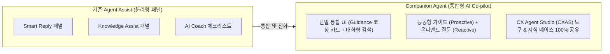

# 01. Companion Agent 개요 및 핵심 개념

> **참고 공식 문서**: [Google Cloud Agent Assist — Companion Agent Overview](https://docs.cloud.google.com/gemini-enterprise-cx/agent-assist/companion-agent-overview)

---

## 1. Companion Agent란 무엇인가요?

**Companion Agent(컴패니언 에이전트)**는 고객 상담 중 **인간 상담원(Human Agent) 옆에서 실시간으로 협업하는 지능형 AI 코파일럿(Co-pilot)**입니다.

기존의 Agent Assist 기능들(문서 추천, 답변 제안, AI 코치 등)은 각각 분리된 패널과 환경에서 개별적으로 동작했기 때문에 상담원이 여러 화면을 동시에 확인해야 하는 부담이 있었습니다. **Companion Agent**는 이러한 지원 기능들을 **단일 통합 인터페이스(Unified Interface)**로 결합하여, 단순 계약 조회부터 복잡한 청구 요금 비교 및 기술 매뉴얼 안내까지 다양한 상담 업무를 한 화면에서 매끄럽게 처리할 수 있도록 돕습니다.

---

## 2. 두 가지 핵심 동작 모드 (Operating Modes)

Companion Agent는 실시간 상담 중에 다음 두 가지 모드로 동작하며, 백그라운드에서 동일한 CX Agent Studio(CXAS) 도구(Tools)와 지식 베이스를 공유합니다.

| 구분 | 능동형 모드 (Proactive Mode — `Guidance agent`) | 온디맨드 어시스턴트 모드 (Reactive Mode — `Ask assistant`) |
| :--- | :--- | :--- |
| **역할** | 대화를 실시간으로 분석하여 **알아서 다음 행동과 답변을 추천** | 상담원이 직접 질문하면 **즉시 근거 기반 답변을 찾아주는 대화형 비서** |
| **트리거 시점** | 고객/상담원의 발화 이벤트 (`Customer message`, `Agent message`, `End of utterance`) 발생 시 자동 실행 | 상담원이 **`Ask assistant` 입력창**에 직접 질문을 입력할 때 실행 |
| **주요 동작** | • 대화 맥락에서 파라미터 자동 추출 및 백엔드 도구 실행 • 상황별 조건부 코칭 카드(**Guidance instruction**) 및 단계별(**Step**) 행동 제시 | • 사내 데이터스토어(매뉴얼/FAQ), OpenAPI, Python 도구 또는 Google 검색 수행 • **Streaming Reactive API**를 통해 실시간 도구 호출 상태 및 출처가 포함된 답변 스트리밍 |
| **활용 예시** | 고객이 *"이번 달 렌탈 요금이 왜 더 많이 나왔나요?"*라고 말하면 자동으로 `compare_invoices` 도구를 호출하고 설명 스크립트 제시 | 상담원이 채팅창에 *"정수기 출수 불량일 때 매뉴얼 점검 순서 알려줘"*라고 직접 검색 |

---

## 3. 핵심 이점 (Key Benefits)

1. **올인원 통합 인터페이스 (Unified Interface)**
   - 자동 코칭 카드(Guidance agent)와 상담원의 직접 질문(Ask assistant)을 하나의 화면에서 모두 관리하여 상담원의 인지적 부하(Cognitive Load)를 크게 줄입니다.
2. **CX Agent Studio (CXAS) 자산 100% 재사용**
   - **CX Agent Studio(CES/CXAS)**에서 가상 상담원(Virtual Agent)용으로 만들어 둔 도구(Python Function Tools, OpenAPI Toolsets, Data Store Tools)를 처음부터 다시 개발할 필요 없이 그대로 가져와 연결할 수 있습니다.
3. **폭넓은 차세대 도구 지원 (Extensive Tool Support)**
   - 사내 지식 베이스(**Data Store**), 외부 REST API 연동(**OpenAPI**), 커스텀 비즈니스 로직(**Custom Python Tools**), 그리고 실시간 웹 정보를 가져오는 **Google 검색 그라운딩(Grounding with Google Search)**까지 모두 지원합니다.
4. **Human-in-the-Loop 안전장치 (`Human confirmation`)**
   - 단순 조회(Read-only) 도구는 상담원 승인 없이 백그라운드에서 즉시 실행(`Confirmation: OFF`)하여 응답 속도를 높이고, 환불·결제·계약 해지 등 시스템 상태를 변경(State-modifying)하는 도구는 상담원이 파라미터를 확인 후 직접 **Confirm(승인)** 버튼을 눌러야만 실행되도록(`Confirmation: ON`) 안전하게 제어할 수 있습니다.

---

## 4. 화면 구성 요소 (Visual Interface)

상담원 데스크톱 및 `Try it out` 시뮬레이터의 우측 Companion Agent 영역은 크게 두 부분으로 나뉩니다:

1. **상단: `Guidance agent` 패널 (Proactive Next Best Action)**
   - 고객과의 대화가 진행됨에 따라 매칭된 **Guidance instruction 카드**가 자동으로 표시됩니다.
   - 여러 장의 카드가 생성된 경우 카드 우측 상단의 **`<` `>` `>|` 페이지네이션 버튼**을 통해 이전 카드나 가장 최신 카드(`>|`)로 이동할 수 있습니다.
   - 하나의 카드 안에 여러 `Step*`이 정의된 경우, 대화가 진행됨에 따라 동일한 카드 내에서 다음 Step으로 자동 전환됩니다.
2. **하단: `Ask assistant` 패널 (Reactive On-Demand Assistant)**
   - 상담원이 대화 도중 언제든지 자연어로 질문하거나 특정 도구 실행을 요청할 수 있는 대화형 창입니다.
   - 상단의 아이콘을 통해 실행된 도구 호출 내역(**Tool history**)과 설정(**Settings**)을 확인할 수 있습니다.
